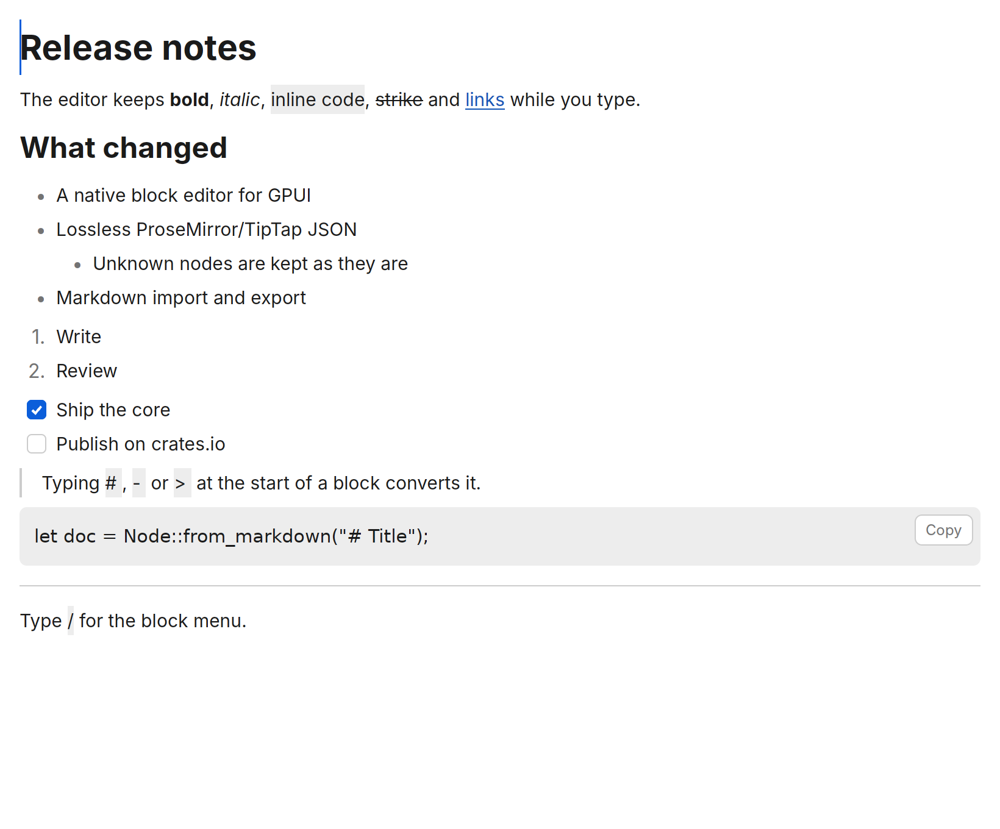
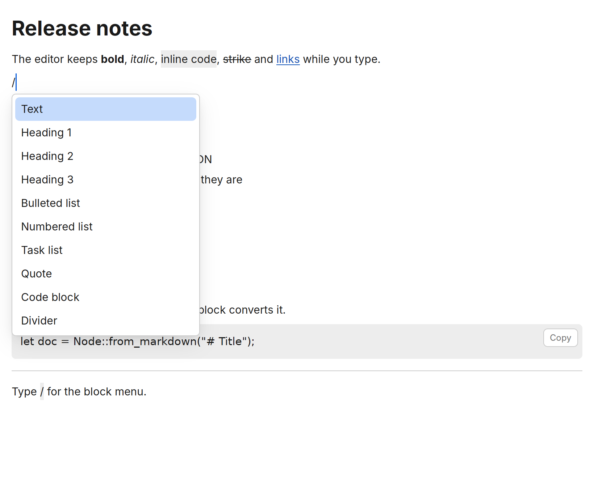
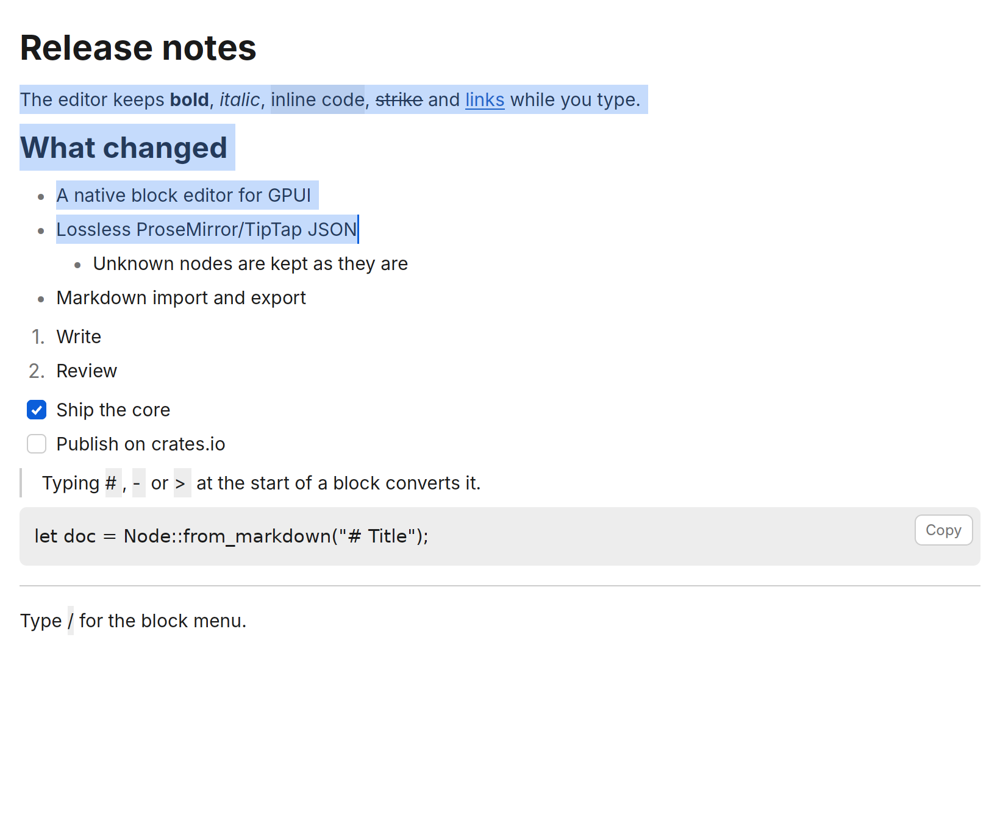
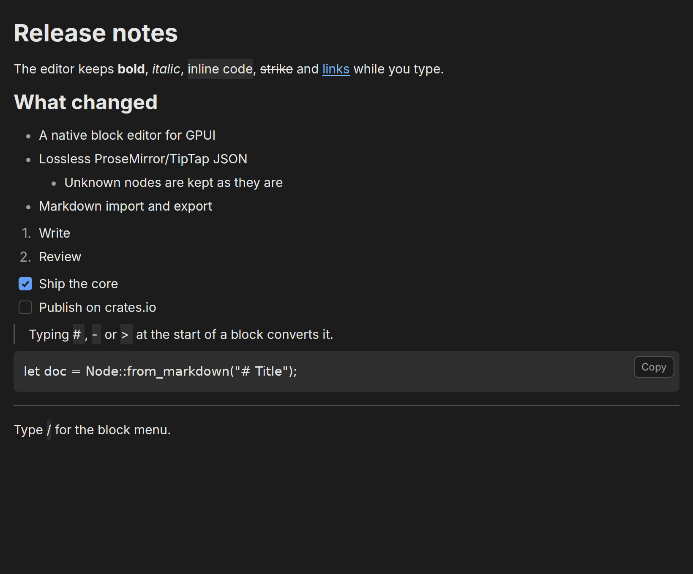
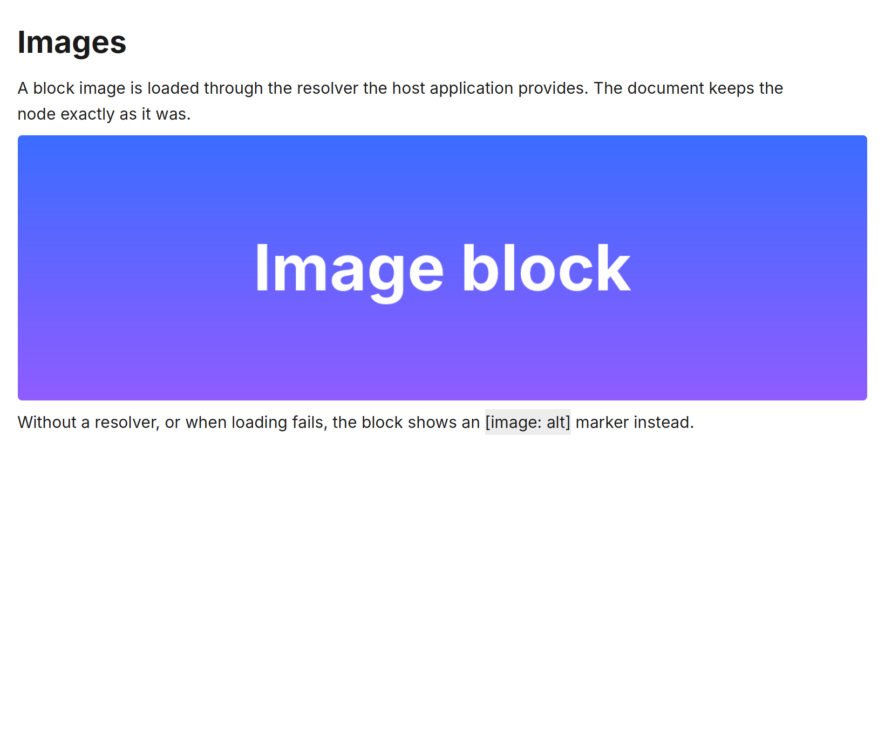

# gpui-editor-ui

[](https://github.com/mattrbdr/gpui-editor-ui/actions/workflows/ci.yml)

A native rich-text block editor for [GPUI](https://www.gpui.rs/), written in Rust, on top of a
UI-independent document core.

- **`gpui-editor-core`** — a headless document model: blocks and marks, a lossless
  ProseMirror/TipTap JSON round trip, an editing engine with undo/redo, Markdown import/export and
  plain-text extraction. It does not depend on GPUI.
- **`gpui-editor-ui`** — a GPUI component (`EditorView`): rendering, caret, selection, mouse,
  keyboard, clipboard, IME, slash menu, mention menu and code-block copy button.



> Status: early (0.1). Both crates work and are covered by tests (117). Nothing is published on
> crates.io yet — depend on it through git.

```toml
[dependencies]
gpui-editor-core = { git = "https://github.com/mattrbdr/gpui-editor-ui" }
gpui-editor-ui   = { git = "https://github.com/mattrbdr/gpui-editor-ui" }
```

`gpui-editor-ui` targets `gpui-pre =0.3.4` (the GPUI build published on crates.io), so it can be used
next to other crates pinned to that version.

## Crates

| Crate | Purpose |
|---|---|
| `gpui-editor-core` | Block document model, lossless ProseMirror/TipTap JSON, plain text, Markdown import/export, editing engine, input rules. No GPUI dependency. |
| `gpui-editor-ui` | The GPUI component: `EditorView`, `EditorTheme`, `EditorEvent`, key bindings. |

## Core guarantees

- A ProseMirror/TipTap document that is read and written back is **byte-identical**: unknown nodes and
  marks are kept, the original key order is kept, empty `attrs` / `content` are restored.
- Only the keys `type`, `attrs`, `content`, `marks` and `text` are read (any other key is ignored);
  `attrs: null` is treated as absent. Keys added after reading follow ProseMirror's canonical order.
- Unknown **inline** nodes inside a paragraph (an emoji node, for example) survive edits of that
  paragraph: they are kept as single atoms.
- **Mentions** (`{"type":"mention","attrs":{"id","label",…}}`) are shown as `[[label]]`, survive edits
  next to them, and turn back into plain text if the user edits their characters by hand.
  `Editor::insert_mention` replaces a typed `[[query` with a mention in one undo step;
  `Editor::mention_near` tells which mention a position touches.

## The GPUI component

```rust
gpui_editor_ui::bind_keys(cx);
let view = cx.new(|cx| EditorView::new(Node::from_markdown("# Title"), EditorTheme::default(), cx));
cx.subscribe(&view, |_, _, event: &EditorEvent, _| match event {
    EditorEvent::Changed => { /* save the document: view.doc().to_json() */ }
    EditorEvent::MentionQuery(text) => { /* look targets up, then view.set_mention_items(..) */ }
    EditorEvent::MentionClicked(id) => { /* Ctrl+click on a mention: open its target */ }
})
.detach();
```

Try it: `cargo run -p gpui-editor-ui --example spike [file.md]`
(`SPIKE_FONT="DejaVu Sans"` picks the font).

- **Editing** — typing, accents and dead keys, IME composition (one undo step), Enter / Shift+Enter,
  deletion by grapheme, word and block, undo/redo, copy/cut/paste, keyboard and mouse selection
  (double click selects a word, triple click a block), Up/Down keep the column.
- **Structure** — headings (Ctrl+Alt+1/2/3), code block, bullet, ordered and task lists
  (Ctrl+Shift+8/7/9), Tab / Shift+Tab to nest, Ctrl+Enter toggles a task.
- **Markdown while typing** — `# ` to `###### ` (headings), `- `, `* `, `+ ` (bullets), `1. ` (ordered
  list), `[ ] ` / `[x] ` (tasks), `> ` (quote) at the start of a block; ```` ```js ```` then Enter (code
  block); `---` then Enter (rule); `**bold**`, `*italic*`, `_italic_`, `` `code` ``, `~~strike~~` when
  the closing delimiter is typed. Undo gives back the text as typed (`# `, `**x**`…).
- **`/` menu** — typed at the start of a word, it offers text, headings 1–3, lists, tasks, quote, code
  block and rule; filter by typing, Up/Down to choose, Enter to apply, Esc to close.
- **`[[` menu** — typing `[[` opens a menu of targets *provided by the host application*: the editor
  emits `EditorEvent::MentionQuery(text)` as the query changes and the host answers with
  `EditorView::set_mention_items(vec![MentionItem { id, title, detail }], cx)`. Enter inserts the
  mention; Esc, a `]`, or moving the caret out of the query closes the menu.
- **Marks** — bold, italic, underline, strike, code (Ctrl+B/I/U/Shift+X/E). **Links**: Ctrl+K emits
  `EditorEvent::LinkRequested(current_href)` (the link, or the word under the caret, is selected) and the host
  answers with `EditorView::apply_link(Some(url) | None, cx)`; Ctrl+click emits `EditorEvent::LinkClicked(href)`.
  Dragging a selection past the top or bottom edge scrolls automatically.
- **Embeds** — an unknown block node that carries a `viewId` attribute can be shown as a card (title,
  subtitle, small table) supplied by the host through `EditorView::set_embeds`; without a card it is
  shown as a `[name]` marker. Either way the node is preserved in the document.
- **Images** — an `image` block is loaded through `EditorView::set_image_resolver(|src| -> Option<ImageSource>)`;
  without a resolver, `file://` URLs and absolute paths are loaded. When there is no source or
  loading fails, the block shows an `[image: alt]` marker. The node is never changed. Images inside
  a paragraph stay markers.
- **Theme** — `EditorTheme` (fonts, colors, sizes) is supplied by the application; `EditorTheme::dark()`
  is a ready-made dark variant. Bold and italic need a font family that has them; `.SystemUIFont`
  does not render them everywhere.

<table>
  <tr>
    <td></td>
    <td></td>
  </tr>
  <tr>
    <td align="center">The <code>/</code> menu</td>
    <td align="center">Selection across blocks</td>
  </tr>
  <tr>
    <td></td>
    <td></td>
  </tr>
  <tr>
    <td align="center"><code>EditorTheme::dark()</code></td>
    <td align="center">An image block</td>
  </tr>
</table>

Known limits: no screen-reader accessibility yet, unknown nodes and inline images are shown as a
`[name]` marker (they are kept in the document), and
IME composition is tested through the input-handler API rather than with a real ibus keyboard.
Every block is laid out on each frame (no virtualization): typing in a 500-block document costs
about 3 ms per keystroke in release, rendering included, so this is left until a real document
needs it.

## Markdown

```rust
use gpui_editor_core::{Flavor, MarkdownOptions, Node};

let doc = Node::from_markdown("# Title\n\nSome **bold**.");
let clean = doc.to_markdown(); // CommonMark + GFM, correctly escaped
let tiptap = doc.to_markdown_with(&MarkdownOptions { flavor: Flavor::TipTapCompat });
```

- **`Flavor::CommonMark`** (default) — correct Markdown. Escapes are limited to what CommonMark
  requires, hard break as `\`, underline as `<u>`, code fences long enough for their content, crossed
  marks reopened with inline HTML.
- **`Flavor::TipTapCompat`** — reproduces `@tiptap/markdown` (the `&amp;` / `&lt;` / `&gt;` entities,
  hard break as two spaces, underline as `++x++`…), defects included, so an export stays identical to
  the one a TipTap application would produce. Verified on 129 cases generated by the real
  `@tiptap/markdown` and on real-world exports.
- **Import** — `Node::from_markdown` produces the structure `@tiptap/markdown` produces (marks written
  from the inside out, `title: null` on links, a lone image promoted to a block). In the
  `TipTapCompat` flavor, a list that mixes bullets and tasks is split into consecutive homogeneous
  lists and tables are dropped, as TipTap does. Deliberate differences: HTML stays text and every entity
  is decoded.
- The fixtures (`tests/fixtures/tiptap_markdown.json`) are generated by `tools/gen-fixtures`
  (`npm install && npm run generate`) and are synthetic.

## Development

```sh
cargo test --workspace
cargo clippy --workspace --all-targets   # pedantic, zero warnings expected
```

CI (`.github/workflows/ci.yml`) runs fmt, clippy and the tests of the core on stable and on the
1.89 `rust-version`, and clippy, the tests and the example of the UI crate on stable.

The `*_for_tests` helpers of `EditorView` (simulated mouse, scroll and caret state) are only
compiled with the `test-support` feature, which the crate's own tests enable.

Timing of the editing engine on a large document (~1,800 text blocks):

```sh
cargo test -p gpui-editor-core --release --test perf -- --ignored --nocapture
```

The screenshots above are generated by `tools/screenshots.sh` (Xvfb, xdotool, ImageMagick and a
Vulkan driver such as Mesa lavapipe) from `docs/screenshots/demo.md` and `docs/screenshots/image-demo.md`.

The UI crate needs GPUI's system libraries (Vulkan, X11/Wayland, fontconfig) and a C compiler;
`.cargo/config.toml` loads fontconfig dynamically (`RUST_FONTCONFIG_DLOPEN`). Under conda, strip the
RPATH (`patchelf --remove-rpath`) before running the example on X11. The core only needs Rust.

### Replaying a real corpus

`tests/corpus.rs` checks the round trip of an external corpus without ever committing it:

```sh
GPUI_EDITOR_CORPUS=/path/to/documents.jsonl cargo test -p gpui-editor-core --test corpus
```

One JSON document per line. Without the variable the test does nothing. Likewise
`GPUI_EDITOR_MARKDOWN_CORPUS` (`{"doc": …, "markdown": "…"}` per line) compares the compatible export
with real exports.

## License

[MIT](LICENSE) — Copyright (c) 2026 Mattéo Ribardiere.
